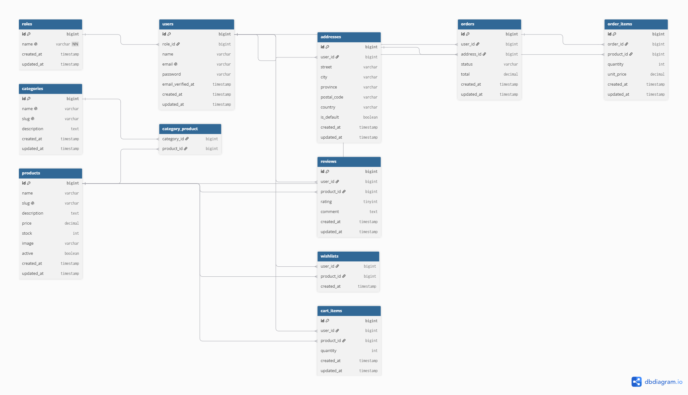

# Sistema de E-Commerce con Laravel

Trabajo Final - Desarrollo de Aplicación Web con Laravel
Materia: Producción Web
Alumno: Roger Joaquín Reales

## 1. Descripción del proyecto y alcance funcional

Sistema de e-commerce que simula una tienda en línea. Los **clientes** pueden
registrarse, explorar el catálogo de productos por categoría, agregar productos
a una lista de deseos (wishlist), gestionar un carrito de compras, confirmar
pedidos, y dejar reseñas de productos que hayan comprado y recibido. Los
**administradores** pueden gestionar (CRUD completo) categorías y productos, y
actualizar el estado de los pedidos realizados por los clientes.

Adicionalmente, se expone un subconjunto de la funcionalidad como API REST
(consulta de catálogo), documentada con una colección de Postman.

**Fuera de alcance:** no se integra una pasarela de pago real (el estado de
pago se simula mediante actualización administrativa del pedido); el envío de
emails está configurado con driver de log, sin envío real a casillas de correo.

## 2. Instalación paso a paso

Requisitos: PHP 8.1+, Composer, MySQL (XAMPP recomendado).

```bash
# 1. Clonar el repositorio
git clone <url-del-repo>
cd tp-final-ecommerce

# 2. Instalar dependencias de PHP
composer install

# 3. Configurar variables de entorno
cp .env.example .env
php artisan key:generate

# 4. Configurar la base de datos en .env
# DB_CONNECTION=mysql
# DB_HOST=127.0.0.1
# DB_PORT=3306
# DB_DATABASE=tp_final_ecommerce
# DB_USERNAME=root
# DB_PASSWORD=

# 5. Crear la base de datos "tp_final_ecommerce" en phpMyAdmin (o por consola)

# 6. Ejecutar migraciones y poblar datos de prueba
php artisan migrate --seed

# 7. Habilitar el storage de imágenes
php artisan storage:link

# 8. Levantar el servidor
php artisan serve
```

> **Nota sobre el frontend:** este proyecto usa Tailwind CSS vía CDN
> (sin build step de Node/Vite), por lo que **no es necesario** correr
> `npm install` ni `npm run dev`. Basta con los pasos de arriba.

Accedé a la aplicación en `http://127.0.0.1:8000`.

## 3. Credenciales de prueba

| Rol | Email | Contraseña |
|-----|-------|------------|
| Administrador | admin@admin.com | 12345678 |
| Cliente | cliente@cliente.com | 12345678 |

## 4. Diagrama Entidad-Relación



El sistema se compone de 11 tablas:

- **roles** — perfiles del sistema (admin/cliente); `users` referencia un rol (1:N).
- **users** — clientes y administradores; tiene muchas `addresses`, `orders`, `reviews` y `cart_items` (1:N en cada caso).
- **addresses** — direcciones de envío de un usuario (1:N desde `users`).
- **categories** ↔ **products** — relación N:M a través de la tabla pivote `category_product`.
- **orders** — pertenece a un `user` y opcionalmente a una `address`.
- **order_items** — pivote N:M entre `orders` y `products`, con atributos propios `quantity` y `unit_price` (precio congelado al momento de compra).
- **reviews** — pivote N:M entre `users` y `products`, con atributos `rating` y `comment`; restricción de unicidad por usuario+producto.
- **wishlists** — pivote N:M simple entre `users` y `products` (sin atributos propios).
- **cart_items** — carrito de compras persistente por usuario, pivote entre `users` y `products` con `quantity`.

## 5. Decisiones de diseño relevantes

- **Roles en tabla aparte** (`roles`) en vez de columna enum simple en `users`, para mayor flexibilidad a futuro.
- **Estado de pedidos con Enum de Laravel** (`App\Enums\OrderStatus`), que valida las transiciones permitidas (`pendiente → pagado → enviado → entregado`, o `cancelado` antes de `enviado`) en la capa de negocio (Controller), no solo en la vista.
- **Carrito persistente en base de datos** (tabla `cart_items`) en vez de sesión, para que no se pierda si el usuario cierra el navegador.
- **Reseñas restringidas a compras entregadas**: un cliente solo puede reseñar un producto si tiene al menos un pedido en estado `entregado` que lo incluya — regla validada en el `ReviewController`, no solo sugerida en el frontend.
- **`unit_price` propio en `order_items`**: se congela el precio al momento de la compra, independiente de si el precio del producto cambia después.
- **Autenticación por sesión nativa de Laravel** (sin Sanctum ni JWT), tal como pide el enunciado; la API REST reutiliza esta misma sesión.
- **Middleware `EnsureUserIsAdmin` custom** (alias `admin`) protege todas las rutas del panel de administración.
- **Tailwind CSS vía CDN** en vez de compilación con Vite/npm, para simplificar el entorno de desarrollo sin sacrificar el requisito de framework CSS.

## 6. Rutas principales

### Sitio (Blade)

| Método | Ruta | Descripción |
|--------|------|-------------|
| GET | `/` | Catálogo de productos (con filtro y búsqueda) |
| GET | `/productos/{product}` | Detalle de producto + reseñas |
| GET/POST | `/login`, `/register` | Autenticación |
| GET | `/carrito` | Ver carrito |
| POST | `/carrito/checkout` | Confirmar pedido |
| GET | `/mis-pedidos` | Pedidos del cliente logueado |
| GET | `/wishlist` | Lista de deseos |
| POST | `/productos/{product}/reviews` | Dejar reseña |
| GET | `/admin` | Panel de administración |
| GET/POST/PUT/DELETE | `/admin/categories`, `/admin/products` | CRUD de categorías y productos |
| GET/PATCH | `/admin/orders` | Gestión de estados de pedidos |

### API REST

| Método | Endpoint | Descripción |
|--------|----------|-------------|
| GET | `/api/products` | Listado de productos con categorías |
| GET | `/api/products/{id}` | Detalle de producto (categorías + reseñas) |
| GET | `/api/categories` | Listado de categorías |

Colección de Postman disponible en `postman_collection.json`.
