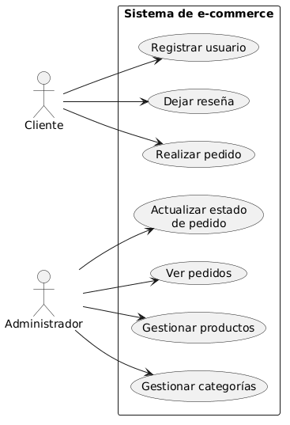

# Relevamiento de Requisitos - Sistema de E-Commerce

Trabajo Final - Desarrollo de Aplicación Web con Laravel

## 1. Actores del sistema

- **Cliente**: usuario registrado en la plataforma. Puede navegar el catálogo
  de productos por categoría, agregar productos a una lista de deseos
  (wishlist), gestionar un carrito de compras, realizar pedidos, y dejar
  reseñas de productos que haya comprado y recibido (estado `entregado`).
- **Administrador**: usuario con privilegios elevados. Gestiona (CRUD
  completo) las categorías y productos del catálogo, y administra las
  transiciones de estado de los pedidos realizados por los clientes.

## 2. Requisitos funcionales (RF)

| ID | Requisito | Actor |
|----|-----------|-------|
| RF01 | El sistema debe permitir a un cliente registrarse con nombre, email y contraseña | Cliente |
| RF02 | El sistema debe permitir el inicio y cierre de sesión seguro para clientes y administradores | Cliente/Admin |
| RF03 | El sistema debe permitir al administrador realizar el CRUD completo de categorías | Administrador |
| RF04 | El sistema debe permitir al administrador realizar el CRUD completo de productos, asociándolos a una o más categorías | Administrador |
| RF05 | El sistema debe permitir a los clientes explorar el catálogo filtrando por categoría y buscando por nombre | Cliente |
| RF06 | El sistema debe permitir agregar y quitar productos de una lista de deseos (wishlist) | Cliente |
| RF07 | El sistema debe permitir gestionar un carrito de compras (agregar, editar cantidad, quitar ítems) | Cliente |
| RF08 | El sistema debe permitir confirmar el carrito generando un pedido (orders) con sus ítems (order_items), calculando el total automáticamente y descontando el stock | Cliente/Sistema |
| RF09 | El sistema debe permitir al cliente asociar una o más direcciones de envío a su perfil | Cliente |
| RF10 | El sistema debe permitir al administrador actualizar el estado de un pedido, respetando las transiciones válidas (pendiente → pagado → enviado → entregado, o cancelado antes de enviado) | Administrador |
| RF11 | El sistema debe permitir a un cliente dejar una reseña (puntuación y comentario) únicamente de productos que haya comprado y que estén en estado entregado | Cliente |
| RF12 | El sistema debe exponer un subconjunto del catálogo como API REST en formato JSON | Sistema |

## 3. Requisitos no funcionales (RNF)

- **RNF01 — Seguridad**: las contraseñas se almacenan hasheadas (Bcrypt).
  Todas las rutas sensibles están protegidas mediante middleware (`auth`,
  `admin` custom), evitando el acceso no autorizado a funciones de gestión
  o compra.
- **RNF02 — Integridad de datos**: la base de datos garantiza integridad
  referencial mediante claves foráneas entre todas las tablas del dominio,
  con reglas de borrado explícitas (`cascade`, `restrict`, `set null` según
  corresponda), además de una restricción de unicidad que permite una sola
  reseña por producto y por usuario.
- **RNF03 — Arquitectura (MVC)**: el proyecto respeta una separación
  estricta de responsabilidades bajo el patrón Modelo-Vista-Controlador
  (Controllers delgados, Form Requests para validación, Models con
  relaciones Eloquent bien definidas), favoreciendo mantenimiento y
  legibilidad.
- **RNF04 — Usabilidad y responsive**: la interfaz es adaptativa,
  desarrollada con Tailwind CSS, garantizando correcta visualización y
  usabilidad tanto en escritorio como en dispositivos móviles.
- **RNF05 — Manejo de errores**: la aplicación presenta mensajes de
  feedback claros ante las acciones del usuario (alertas de éxito/error
  mediante `session`), y respuestas controladas ante peticiones fallidas
  en la API (por ejemplo, 404 Not Found cuando un producto no existe).

## 4. Casos de uso principales

| Caso de uso | Actor | Descripción breve |
|---|---|---|
| Registrar usuario | Cliente | Alta de cuenta con nombre, email y contraseña |
| Gestionar catálogo | Administrador | CRUD completo de productos y categorías |
| Realizar pedido | Cliente | Confirma el carrito y genera una orden con sus ítems |
| Dejar reseña | Cliente | Publica calificación y comentario sobre un producto entregado |
| Actualizar estado de pedido | Administrador | Modifica el estado de una orden respetando las transiciones válidas |

## 5. Alcance y supuestos

**Alcance:**
El sistema abarca el ciclo de vida completo de la compra dentro de la
plataforma: catálogo, wishlist, carrito, pedido, reseña, y gestión
administrativa de categorías, productos y estados de pedido. Se entrega
además un conjunto de rutas API REST para consulta del catálogo,
documentadas y probadas mediante una colección de Postman.

**Fuera de alcance:**
- No se integra una pasarela de pago real (como Mercado Pago o Stripe). El
  cambio de estado de pago se simula mediante la actualización
  administrativa manual del estado del pedido.
- No se realiza el envío efectivo de emails a casillas de correo reales
  (configurado con driver de prueba/log).

**Supuestos:**
- Todo registro nuevo se asigna automáticamente al rol `cliente`; la única
  cuenta con rol `administrador` existe por medio del seeder inicial.
- El carrito de compras se persiste en base de datos por usuario (no en
  sesión del navegador), para que no se pierda si el cliente cierra o
  cambia de dispositivo.
